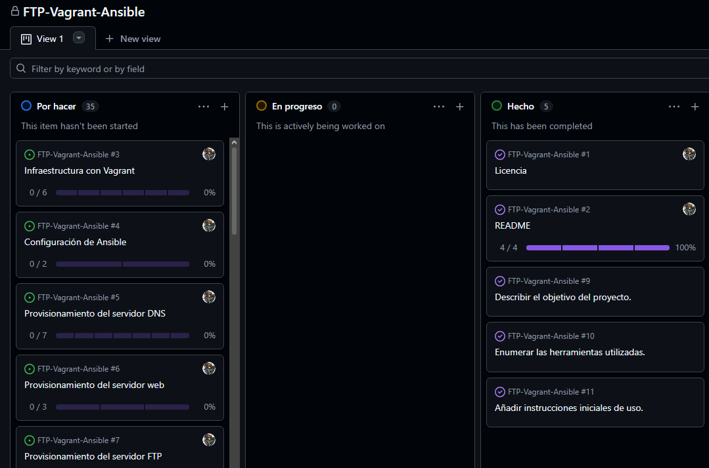
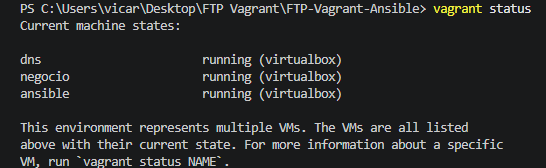

# FTP con Vagrant y Ansible

**Autor:** FºJavier Vicaria Garcia
**Repositorio:** https://github.com/FcoJavierVGizv/FTP-Vagrant-Ansible

## Objetivo

Desplegar de forma automatizada una infraestructura de tres máquinas virtuales
con Vagrant y configurarla con Ansible desde un nodo controlador:

- `dns.franciscoj.test`: servidor DNS (BIND9).
- `negocio.franciscoj.test`: servidor web (Apache) y servidor FTP seguro con TLS (vsftpd).
- `ansible.franciscoj.test`: nodo controlador desde el que se ejecuta Ansible.

## Herramientas utilizadas

- **GitHub** y **GitHub Projects**: repositorio y gestión de tareas.
- **Vagrant** y **VirtualBox**: creación de las máquinas virtuales (Debian Bookworm).
- **Ansible** y **Ansible Vault**: provisionamiento y cifrado de contraseñas.
- **BIND9**: servidor DNS.
- **Apache2**: servidor web.
- **vsftpd**: servidor FTP con TLS.
- **FileZilla** o **WinSCP**: cliente FTP para las pruebas.

## Puesta en marcha

### Requisitos

- VirtualBox
- Vagrant
- Git

### Pasos básicos

1. Clonar el repositorio:
   ```bash
   git clone https://github.com/FcoJavierVGizv/FTP-Vagrant-Ansible.git
   cd FTP-Vagrant-Ansible
   ```
2. Levantar las máquinas virtuales:
   ```bash
   vagrant up
   ```
3. Entrar en el nodo de control:
   ```bash
   vagrant ssh ansible
   ```

   ## Gestión del proyecto



## Infraestructura con Vagrant

Se definen tres máquinas virtuales basadas en `debian/bookworm64` en la red privada 192.168.57.0/24:

| Máquina | Nombre | IP | Función |
|---|---|---|---|
| dns | dns.franciscoj.test | 192.168.57.5 | Servidor DNS |
| ansible | ansible.franciscoj.test | 192.168.57.6 | Nodo de control de Ansible |
| negocio | negocio.franciscoj.test | 192.168.57.7 | Servidor web y FTP seguro |

